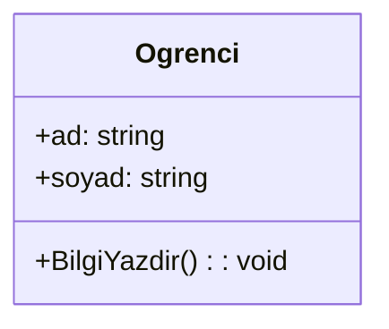
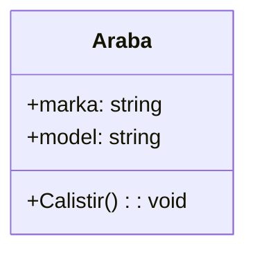
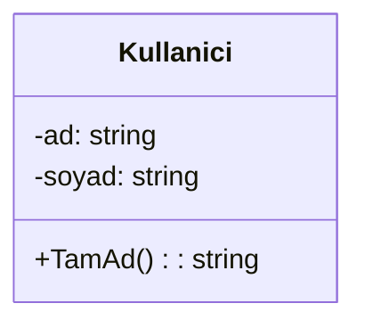
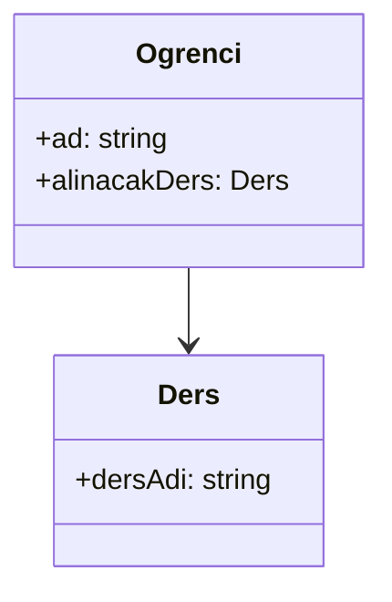
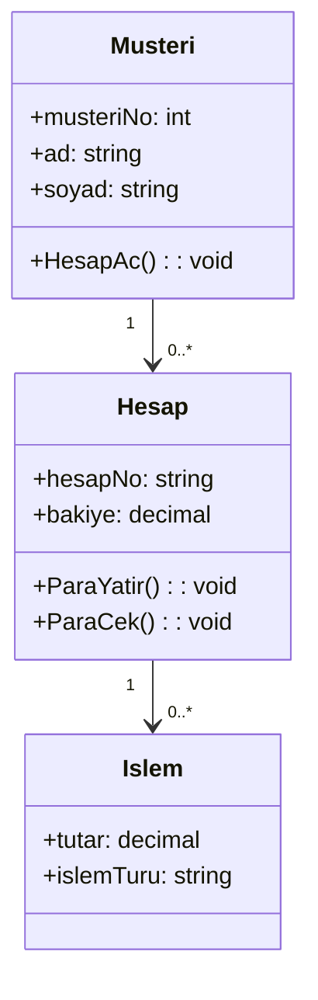
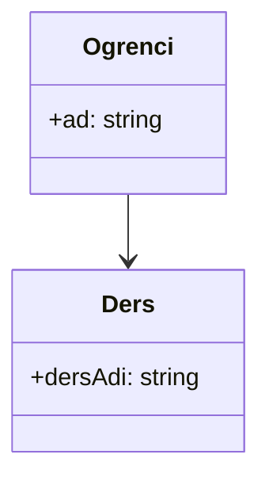
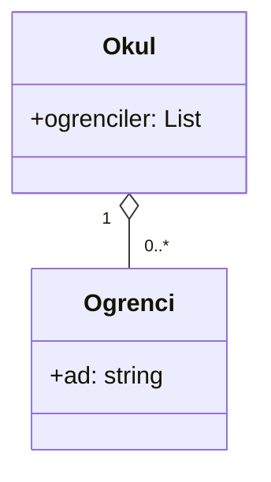
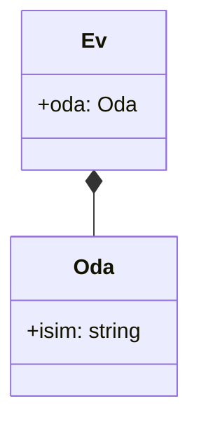

# Sınıf Diyagramına Giriş

Bu konuya başlarken en önemli şey şudur: sınıf diyagramı, bir yazılımın "şablonunu" görsel olarak gösterir. Kısacası, bir sınıfta ne bilgilerin (özellikler) olduğunu ve ne iş yapabildiğini (metotlar) tek bakışta görmemizi sağlar.

Bu dokümanda konuyu çok basit örneklerle anlatacağız. Adım adım ilerlediğimiz için öğrenciler kolayca anlayacaktır.

## Mermaid ile ilk örnek

Aşağıdaki görsel, sınıf diyagramının en temel halini gösterir. Bu örnek aynı anda hem sınıfın adı hem özellikleri hem de davranışı anlatır.



Bu diyagramda:

- `Ogrenci` adında bir sınıf vardır.
- `ad` ve `soyad` özelliklerdir.
- `BilgiYazdir()` metottur.

> Not: Mermaid diyagramı Markdown önizleme (Preview) açıkken görünür. Dosyayı doğrudan editörde değil, Markdown Preview ile açarsanız grafik net şekilde görünecektir.

## 1) Sınıf nedir?

Sınıf, bir nesnenin nasıl oluşturulacağını tanımlayan taslaktır. Bir sınıf içinde:

- özellikler (alanlar) bulunur
- metotlar bulunur
- nesnenin davranışları tanımlanır

Örnek:

```csharp
class Araba
{
    public string marka;
    public string model;

    public void Calistir()
    {
        Console.WriteLine("Araba çalıştı.");
    }
}
```

Bu örnekte:

- `marka` ve `model` sınıfın özellikleridir.
- `Calistir()` metodu sınıfın davranışıdır.

Şimdi bunu sınıf diyagramı ile gösterelim:



Bu diyagramın anlamı:

- `Araba` adında bir sınıf var.
- Sınıfın `marka` ve `model` özellikleri var.
- `Calistir()` metodu vardır.

## 2) Sınıf diyagramında ne görürüz?

Bir sınıf diyagramında genellikle şu kısımlar bulunur:

- Sınıf adı
- Özellikler
- Metotlar
- Erişim belirleyicileri

### Erişim belirleyicileri

- `+` : public (her yerden erişilebilir)
- `-` : private (sadece sınıf içinden erişilir)
- `#` : protected (kalıtım alan sınıflar erişebilir)

Örnek:



Bu diyagramı okuma yöntemi:

- `Kullanici` sınıfı vardır.
- `ad` ve `soyad` özellikleri private yani gizlidir.
- `TamAd()` metodu publictir ve kullanıma açıktır.

## 3) Adım adım basit örnek: Öğrenci sınıfı

Şimdi öğrenciler için daha anlaşılır bir örnek yapalım.

### Örnek 1: Tek sınıf

```csharp
class Ogrenci
{
    public string ad;
    public string soyad;

    public void BilgiYazdir()
    {
        Console.WriteLine(ad + " " + soyad);
    }
}
```

Bu sınıfın sınıf diyagramı:


Bu örnekte:

- Öğrencinin adı ve soyadı vardır.
- Öğrenci bilgileri ekrana yazdırılabilir.

## 4) Sınıflar arasında ilişki kurma

Şimdi birden fazla sınıfın nasıl ilişkilendirildiğini görelim.

### Örnek 2: Öğrenci ve Ders ilişkisi

```csharp
class Ders
{
    public string dersAdi;
}

class Ogrenci
{
    public string ad;
    public Ders alinacakDers;
}
```

Bu örneğin diyagramı:



Bu diyagramın anlamı:

- Öğrenci bir ders bilgisine sahip olabilir.
- `Ogrenci` sınıfı ile `Ders` sınıfı arasında ilişki vardır.
- `Ogrenci` -> `Ders` şeklinde gösterilir.

## 5) Biraz daha gerçekçi örnek: Banka sistemi

Şimdi anlaşılır bir sistem örneği görelim.

### Sınıflar:

- `Musteri`
- `Hesap`
- `Islem`

### Örnek yapı:



Bu diyagramda şunları görürüz:

- Bir müşteri birden fazla hesaba sahip olabilir.
- Her hesap birden fazla işlem yapabilir.
- Bu ilişki sınıf diyagramında okunur.

## 6) Sınıf diyagramında ilişki türleri

Sınıf diyagramında sınıflar arasında ilişkiler kurulur. Bu ilişkiler, nesnelerin birbirine nasıl bağlı olduğunu anlatır. En yaygın üç ilişki türü şunlardır:

- Association (ilişki)
- Aggregation (toplama)
- Composition (bileşim)

Şimdi bunları basit örneklerle görelim.

### 6.1) Association (İlişki)

Association, iki sınıfın nesneleri arasındaki bağlantıdır. Bu bağlantıda nesneler birbirinin parçası değildir.

En basit örnek: Bir öğrenci bir dersin içinde olabilir ama ders, öğrencinin bir parçası değildir.

```csharp
class Ogrenci
{
    public string ad;
}

class Ders
{
    public string dersAdi;
}
```

Mermaid diyagramı:



Bu ilişki şu anlama gelir:

- Öğrenci ile ders arasında bağlantı vardır.
- Ama ders, öğrencinin bir parçası değildir.
- Öğrenci ders alabilir; ders de öğrenciye ait olabilir.

### 6.2) Aggregation (Toplama)

Aggregation, bir sınıfın başka bir sınıfı tuttuğu ama onun sahibi olmadığı durumdur. Yani büyük nesne, küçük nesneyi barındırır ama onun yaşam döngüsünü kontrol etmez.

Örnek: Okul, öğrencileri barındırır. Ancak öğrenciler okuldan ayrı da yaşayabilir.

```csharp
class Ogrenci
{
    public string ad;
}

class Okul
{
    public List<Ogrenci> ogrenciler;
}
```

Mermaid diyagramı:



Bu ilişki şu anlama gelir:

- Okul, öğrencileri tutar.
- Öğrenciler okulun bir parçası gibi görünür ama bağımsızdır.
- Okul kapansa bile öğrenciler var olabilir.

### 6.3) Composition (Bileşim)

Composition, bir sınıfın başka sınıfı tamamen kendi içinde oluşturduğu ve onun yaşam döngüsünü kontrol ettiği ilişkidir. Bu durumda parça, bütünün bir parçasıdır.

Örnek: Bir evin odaları vardır. Oda, evin bir parçasıdır; ev yoksa oda da olmaz.

```csharp
class Oda
{
    public string isim;
}

class Ev
{
    public Oda oda;
}
```

Mermaid diyagramı:



Bu ilişki şu anlama gelir:

- Ev, odanın sahibi gibidir.
- Oda evin bir parçasıdır.
- Ev silinirse oda da kaybolur.

### 6.4) Kısa farklar

- Association: iki sınıf birbirine bağlıdır ama bağımsızdır.
- Aggregation: büyük nesne küçük nesneyi taşır ama onu kontrol etmez.
- Composition: büyük nesne küçük nesnenin yaşamını tamamen yönetir.

### 6.5) Basit hatırlama yöntemi

- Association = iki nesne arasında bağlantı vardır.
- Aggregation = bütün, parçaları bir arada tutar; parçalar tek başına da var olabilir.
- Composition = parçalar bütüne bağlıdır; bütün ortadan kalkarsa parçalar da varlığını yitirir.

## 7) Sınıf diyagramı neden kullanılır?

Sınıf diyagramı kullanmanın faydaları şunlardır:

- Sistemin yapısını görsel olarak anlaşılır hale getirir.
- Sınıflar arasındaki ilişkileri kolay gösterir.
- Kod yazmadan önce tasarım oluşturur.
- Takım çalışmasında herkesin aynı anlayışı paylaşmasını sağlar.
- Yazılımın daha düzenli ve sürdürülebilir olmasına yardımcı olur.

## 8) Kısa özet

Sınıf diyagramı, bir yazılım sisteminin sınıflarını ve aralarındaki ilişkileri gösteren görsel bir tasarım aracıdır.

Basit mantık şöyledir:

- Sınıf = şablon
- Özellik = veri
- Metot = davranış
- İlişki = sınıflar arası bağlantı

Bu yüzden sınıf diyagramı, nesne yönelimli programlamada çok önemli bir konudur.

## 9) Alıştırma

Aşağıdaki senaryoya uygun bir sınıf diyagramı çiziniz:

- Bir okul sisteminde `Ogrenci`, `Ders` ve `Ogretmen` sınıfları vardır.
- Her öğrencinin ad, soyad ve numarası vardır.
- Her dersin adı ve kredisi vardır.
- Her öğretmenin adı ve branşı vardır.
- Bir öğrenci birden fazla derse kayıt olabilir.
- Bir öğretmen birden fazla dersi verebilir.

## 10) Son not

Konu başlarda biraz soyut görünebilir. Ancak örnekler küçük ve basit olduğunda anlaşılması çok kolaylaşır. Bu yüzden sınıf diyagramında önce tek sınıfı, sonra iki sınıfı ve ardından ilişkiyi öğrenmek en doğru yoldur.
Sınıf diyagramı, bir yazılım sisteminin sınıflarını ve aralarındaki ilişkileri gösteren görsel bir tasarım aracıdır.

Basit mantık şöyledir:

- Sınıf = şablon
- Özellik = veri
- Metot = davranış
- İlişki = sınıflar arası bağlantı

Bu yüzden sınıf diyagramı, nesne yönelimli programlamada çok önemli bir konudur.

## 8) Alıştırma

Aşağıdaki senaryoya uygun bir sınıf diyagramı çiziniz:

- Bir okul sisteminde `Ogrenci`, `Ders` ve `Ogretmen` sınıfları vardır.
- Her öğrencinin ad, soyad ve numarası vardır.
- Her dersin adı ve kredisi vardır.
- Her öğretmenin adı ve branşı vardır.
- Bir öğrenci birden fazla derse kayıt olabilir.
- Bir öğretmen birden fazla dersi verebilir.

## 9) Son not

Konu başlarda biraz soyut görünebilir. Ancak örnekler küçük ve basit olduğunda anlaşılması çok kolaylaşır. Bu yüzden sınıf diyagramında önce tek sınıfı, sonra iki sınıfı ve ardından ilişkiyi öğrenmek en doğru yoldur.