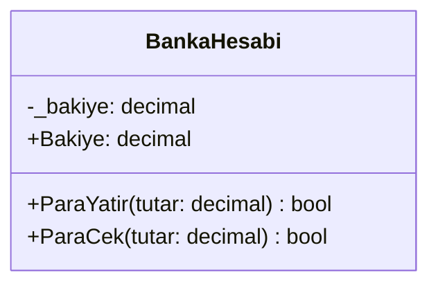
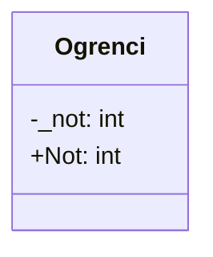
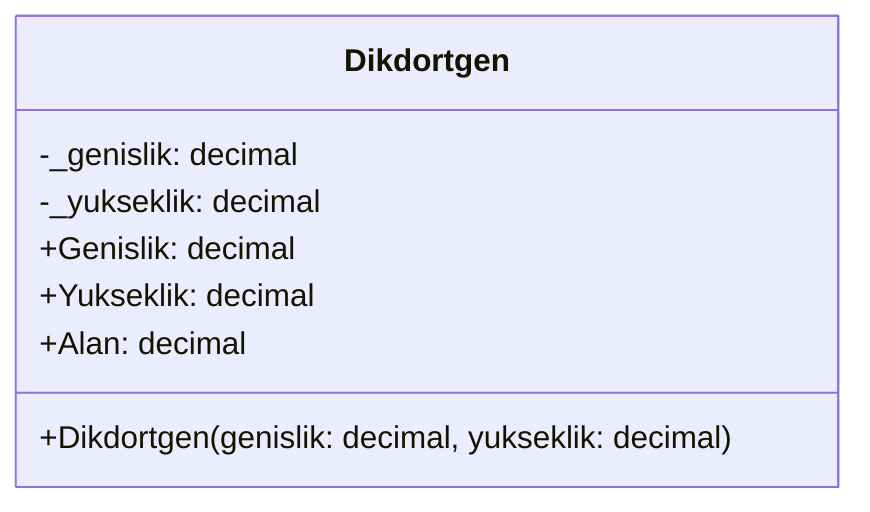
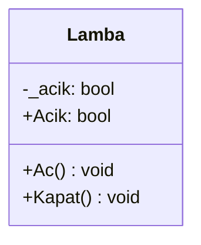
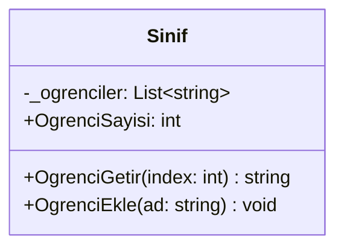

# Hafta 04 — Kapsülleme (Encapsulation)

## Kapsülleme nedir?

Kapsülleme, bir nesnenin verilerini dışarıdan doğrudan değiştirmeye kapatıp bu verilere kontrollü erişim sağlamaktır. Sınıf, verinin nasıl okunacağını veya değiştirileceğini belirler.

Örneğin bir banka hesabının bakiyesi herkes tarafından istenildiği gibi değiştirilememelidir. Para yatırma ve çekme işlemleri kurallara uygun şekilde yapılmalıdır.

C# dilinde kapsülleme için sık kullanılan araçlar:

- `private`: Alana veya metoda yalnızca aynı sınıf içinden erişilebilir.
- `public`: Sınıfın dışından erişilebilir.
- Özellikler (properties) ve metotlar: Sınıfın verilerine kontrollü erişim sağlar.

Sınıf diyagramlarında `-` işareti `private`, `+` işareti `public` anlamına gelir. Aşağıdaki her örnekte önce sınıf diyagramı, ardından C# kodu verilmiştir.

## Field ve Property (Özellik) nedir?

- **Field (alan)**, sınıfın verisini saklayan değişkendir. Kapsüllemede field genellikle `private` yapılır; böylece sınıf dışından doğrudan değiştirilemez.
- **Property (özellik)**, bir field değerini okumak veya kontrollü biçimde değiştirmek için sınıfın dışarıya sunduğu arayüzdür.
- `get`, property değerini okumayı sağlar. Aşağıdaki örnekte `Ad` okunduğunda `_ad` değeri döndürülür.
- `set`, property değerini değiştirmeyi sağlar. Yeni değer `value` adlı özel değişkende bulunur.
- `get` veya `set` tek başına da kullanılabilir. Örneğin yalnızca `get` varsa değer dışarıdan okunabilir ama değiştirilemez; `private set` varsa değer sadece sınıf içinden değiştirilebilir.

```csharp
class Kisi
{
    private string _ad; // Field: veri burada saklanır.

    public string Ad // Property: field'a kontrollü erişim sağlar.
    {
        get { return _ad; }
        set { _ad = value; }
    }
}
```

`Kisi` sınıfının dışından `kisi.Ad` okunabilir ve `kisi.Ad = "Ayşe";` ile değiştirilebilir. `_ad` alanına ise doğrudan erişilemez.

## Örnek 1 — Banka hesabı

Bakiye dışarıdan doğrudan değiştirilemez. Para yatırma ve çekme işlemleri hesap kurallarını kontrol eder.

### Sınıf diyagramı



### C# kodu

```csharp
using System;

class BankaHesabi
{
    private decimal _bakiye;

    public decimal Bakiye
    {
        get { return _bakiye; }
    }

    public bool ParaYatir(decimal tutar)
    {
        if (tutar <= 0)
            return false;

        _bakiye += tutar;
        return true;
    }

    public bool ParaCek(decimal tutar)
    {
        if (tutar <= 0 || tutar > _bakiye)
            return false;

        _bakiye -= tutar;
        return true;
    }
}

class Program
{
    static void Main()
    {
        BankaHesabi hesap = new BankaHesabi();

        hesap.ParaYatir(500);
        hesap.ParaCek(120);

        Console.WriteLine($"Güncel bakiye: {hesap.Bakiye} TL");
    }
}
```

`_bakiye` alanı `private` olduğu için `hesap._bakiye = -100;` gibi bir atama yapılamaz. Bakiye yalnızca sınıfın sunduğu işlemlerle değişir.

## Örnek 2 — Öğrenci notu

Not yalnızca 0 ile 100 arasında olabilir. Özelliğin `set` bölümü bu kuralı uygular.

### Sınıf diyagramı



### C# kodu

```csharp
using System;

class Ogrenci
{
    private int _not;

    public int Not
    {
        get { return _not; }
        set
        {
            if (value < 0 || value > 100)
                throw new ArgumentOutOfRangeException(
                    nameof(value), "Not 0 ile 100 arasında olmalıdır.");

            _not = value;
        }
    }
}

class Program
{
    static void Main()
    {
        Ogrenci ogrenci = new Ogrenci();
        ogrenci.Not = 85;
        Console.WriteLine($"Öğrenci notu: {ogrenci.Not}");
    }
}
```

Örneğin `ogrenci.Not = 120;` ataması kuralı ihlal ettiği için kabul edilmez.

## Örnek 3 — Dikdörtgen

Dikdörtgenin kenar uzunlukları oluşturulurken kontrol edilir. Alan, kenarlardan hesaplandığı için dışarıdan değiştirilemez.

### Sınıf diyagramı



### C# kodu

```csharp
using System;

class Dikdortgen
{
    private decimal _genislik;
    private decimal _yukseklik;

    public Dikdortgen(decimal genislik, decimal yukseklik)
    {
        if (genislik <= 0)
            throw new ArgumentOutOfRangeException(nameof(genislik));
        if (yukseklik <= 0)
            throw new ArgumentOutOfRangeException(nameof(yukseklik));

        _genislik = genislik;
        _yukseklik = yukseklik;
    }

    public decimal Genislik
    {
        get { return _genislik; }
    }

    public decimal Yukseklik
    {
        get { return _yukseklik; }
    }

    public decimal Alan
    {
        get { return _genislik * _yukseklik; }
    }
}

class Program
{
    static void Main()
    {
        Dikdortgen dikdortgen = new Dikdortgen(5, 3);
        Console.WriteLine($"Dikdörtgenin alanı: {dikdortgen.Alan}");
    }
}
```

`Alan` yalnızca okunabilir. Böylece alanın kenar uzunluklarıyla tutarsız bir değere ayarlanması önlenir.

## Örnek 4 — Lamba

Lambanın açık veya kapalı durumu dışarıdan doğrudan değiştirilemez. Durum, `Ac` ve `Kapat` metotlarıyla değiştirilir.

### Sınıf diyagramı



### C# kodu

```csharp
using System;

class Lamba
{
    private bool _acik;

    public bool Acik
    {
        get { return _acik; }
    }

    public void Ac()
    {
        _acik = true;
    }

    public void Kapat()
    {
        _acik = false;
    }
}

class Program
{
    static void Main()
    {
        Lamba lamba = new Lamba();
        lamba.Ac();
        Console.WriteLine($"Lamba açık mı? {lamba.Acik}");

        lamba.Kapat();
        Console.WriteLine($"Lamba açık mı? {lamba.Acik}");
    }
}
```

`lamba.Acik = true;` yazılamaz; durumu değiştirmek için sınıfın tanımladığı metotlar kullanılmalıdır.

## Örnek 5 — Sınıf ve öğrenci listesi

Öğrenci listesi sınıfın içinde tutulur. Dışarıdaki kod öğrenci sayısını öğrenebilir ve öğrencileri tek tek görebilir; listeye ekleme işlemini ise sınıfın metodu yönetir.

### Sınıf diyagramı



### C# kodu

```csharp
using System;
using System.Collections.Generic;

class Sinif
{
    private List<string> _ogrenciler = new List<string>();

    public int OgrenciSayisi
    {
        get { return _ogrenciler.Count; }
    }

    public string OgrenciGetir(int index)
    {
        return _ogrenciler[index];
    }

    public void OgrenciEkle(string ad)
    {
        if (string.IsNullOrWhiteSpace(ad))
            throw new ArgumentException("Öğrenci adı boş olamaz.", nameof(ad));

        _ogrenciler.Add(ad);
    }
}

class Program
{
    static void Main()
    {
        Sinif sinif = new Sinif();
        sinif.OgrenciEkle("Ayşe");
        sinif.OgrenciEkle("Mehmet");

        for (int i = 0; i < sinif.OgrenciSayisi; i++)
        {
            Console.WriteLine(sinif.OgrenciGetir(i));
        }
    }
}
```

Dışarıdaki kod `_ogrenciler` listesine doğrudan erişemediği için listeye öğrenci ekleyemez veya listeden öğrenci silemez. Öğrencileri görmek için `OgrenciSayisi` ve `OgrenciGetir` kullanılır; eklemek için `OgrenciEkle` çağrılır. Böylece listeyi değiştirme yetkisi `Sinif` sınıfında kalır ve ekleme sırasında ad kontrolü yapılabilir.

## Kısa özet

- Verileri doğrudan değiştirmeye açmayın; alanları gerektiğinde `private` yapın.
- Veriye erişim ve değişiklik için anlaşılır `public` özellikler veya metotlar sunun.
- Değerleri değiştirirken kuralları kontrol edin.
- Hesaplanabilen veya dışarıdan değiştirilmemesi gereken bilgileri salt okunur sunun.
