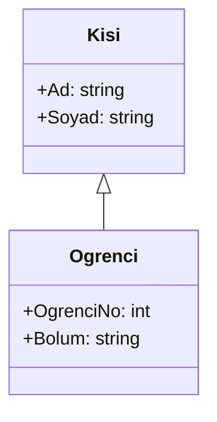
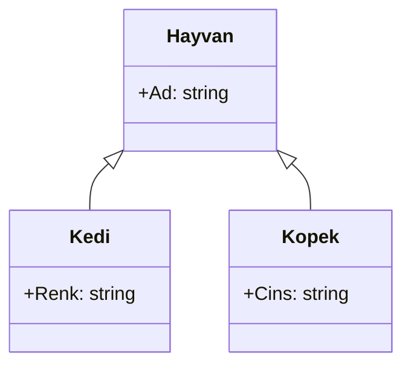
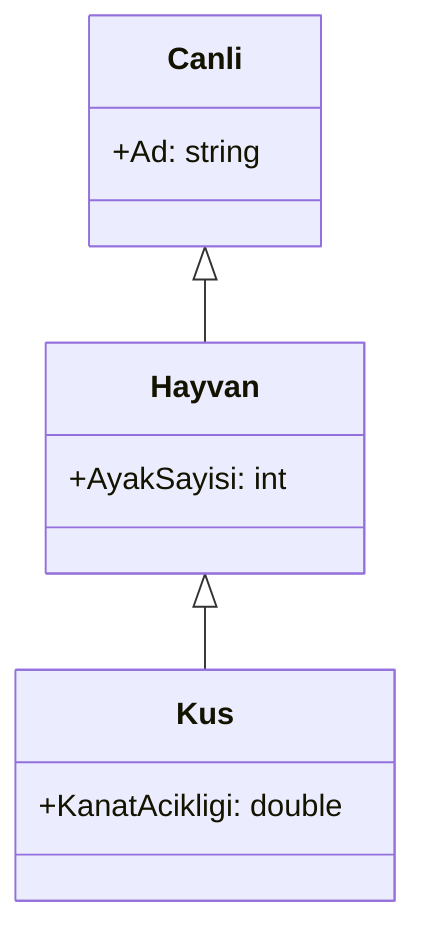

# Hafta 05 — Kalıtım

Bu hafta yalnızca **kalıtımın temel kullanımını** öğreneceğiz. Basit bir örnekle başlayıp aynı üst sınıftan türeyen sınıfları ve birden fazla düzeyden oluşan sınıf hiyerarşisini inceleyeceğiz. Her örnekte önce sınıf diyagramı, ardından bu diyagrama karşılık gelen C# kodu yer alır.

## Öğrenme hedefleri

Bu dokümanın sonunda:

- Kalıtımın ne zaman kullanılacağını açıklayabilecek,
- Bir alt sınıfı `:` işaretiyle tanımlayabilecek,
- Üst sınıfın özelliklerini alt sınıfta kullanabilecek,
- Aynı üst sınıftan türeyen sınıfları ve çok düzeyli bir sınıf hiyerarşisini tanıyabileceksiniz.

## 1. Kalıtım nedir?

Kalıtım, ortak özellik ve davranışları bir **üst sınıfta** tanımlayıp bunları daha özel **alt sınıflarda** kullanmamızı sağlar.

Örneğin her öğrencinin adı ve soyadı vardır. Öğrenciye özgü öğrenci numarası ve bölüm bilgisi de bulunur. `Ogrenci`, ortak kişi bilgilerini `Kisi` sınıfından alabilir.

Bir alt sınıf gerçekten üst sınıfın özel bir türü olmalıdır. “Öğrenci bir kişi midir?” sorusunun cevabı evet olduğu için bu örnekte kalıtım uygundur.

### Örnek 1 — Kişi ve öğrenci

**Sınıf diyagramı**



**C# kodu**

```csharp
using System;

class Kisi
{
    public string Ad { get; set; } = "";
    public string Soyad { get; set; } = "";
}

class Ogrenci : Kisi
{
    public int OgrenciNo { get; set; }
    public string Bolum { get; set; } = "";
}

class Program
{
    static void Main()
    {
        Ogrenci ogrenci = new Ogrenci();
        ogrenci.Ad = "Ayşe";
        ogrenci.Soyad = "Yılmaz";
        ogrenci.OgrenciNo = 2025001;
        ogrenci.Bolum = "Bilgisayar Programcılığı";

        Console.WriteLine($"{ogrenci.Ad} {ogrenci.Soyad}");
        Console.WriteLine($"Bölüm: {ogrenci.Bolum}");
    }
}
```

`class Ogrenci : Kisi` ifadesi, `Ogrenci` sınıfının `Kisi` sınıfından kalıtım aldığını gösterir. Bu nedenle `Ogrenci` nesnesi hem `Ad` ve `Soyad` özelliklerine hem de kendi `OgrenciNo` ve `Bolum` özelliklerine sahiptir.

Diyagramdaki boş üçgenli ok üst sınıfı gösterir. Okun ucu `Kisi` sınıfına baktığı için `Kisi` üst sınıf, `Ogrenci` alt sınıftır.

## 2. Aynı üst sınıftan türeyen sınıflar

Birden fazla sınıf aynı üst sınıftan kalıtım alabilir. Böylece bu sınıflar ortak özellikleri üst sınıftan alırken kendilerine özgü özellikleri de korur.

### Örnek 2 — Hayvan, kedi ve köpek

**Sınıf diyagramı**



**C# kodu**

```csharp
using System;

class Hayvan
{
    public string Ad { get; set; } = "";
}

class Kedi : Hayvan
{
    public string Renk { get; set; } = "";
}

class Kopek : Hayvan
{
    public string Cins { get; set; } = "";
}

class Program
{
    static void Main()
    {
        Kedi kedi = new Kedi();
        kedi.Ad = "Mırmır";
        kedi.Renk = "Tekir";

        Kopek kopek = new Kopek();
        kopek.Ad = "Karabaş";
        kopek.Cins = "Sivas Kangalı";

        Console.WriteLine($"{kedi.Ad}: {kedi.Renk}");
        Console.WriteLine($"{kopek.Ad}: {kopek.Cins}");
    }
}
```

`Kedi` ve `Kopek`, `Hayvan` sınıfından kalıtım alır. Bu nedenle ikisi de `Ad` özelliğine sahiptir. `Renk` yalnızca `Kedi` sınıfında, `Cins` ise yalnızca `Kopek` sınıfında bulunur.

## 3. Birden fazla düzeyden oluşan kalıtım

Bir sınıf, başka bir alt sınıfın devamı olabilir. Bu durumda en üstteki sınıfın özellikleri, aradaki sınıf üzerinden en alttaki sınıfa da aktarılır.

### Örnek 3 — Canlı, hayvan ve kuş

**Sınıf diyagramı**



**C# kodu**

```csharp
using System;

class Canli
{
    public string Ad { get; set; } = "";
}

class Hayvan : Canli
{
    public int AyakSayisi { get; set; }
}

class Kus : Hayvan
{
    public double KanatAcikligi { get; set; }
}

class Program
{
    static void Main()
    {
        Kus kus = new Kus();
        kus.Ad = "Martı";
        kus.AyakSayisi = 2;
        kus.KanatAcikligi = 1.2;

        Console.WriteLine($"Ad: {kus.Ad}");
        Console.WriteLine($"Ayak sayısı: {kus.AyakSayisi}");
        Console.WriteLine($"Kanat açıklığı: {kus.KanatAcikligi} metre");
    }
}
```

`Kus`, doğrudan `Hayvan` sınıfından; `Hayvan` da `Canli` sınıfından kalıtım alır. Bu yüzden `Kus` nesnesi hem `KanatAcikligi` hem `AyakSayisi` hem de `Ad` özelliklerini kullanabilir.

## 4. Kalıtım kullanırken dikkat edilecekler

- **“Bir türüdür” kontrolü yapın:** `Ogrenci`, bir `Kisi` türüdür; bu nedenle örnekte kalıtım anlamlıdır.
- **Ortak olanı üst sınıfa koyun:** Alt sınıflarda gerçekten ortak olan özellik ve davranışları üst sınıfta tutun.
- **Alt sınıfa özgü olanı alt sınıfta bırakın:** Örneğin `KapiSayisi`, her araç için geçerli olmadığından `Araba` sınıfında bulunur.
- **Sırf kodu tekrar etmemek için kalıtım kullanmayın:** Alt sınıfın üst sınıfla gerçek bir “bir türüdür” ilişkisi yoksa bu ilişkiyi kurmayın.
- **C# sınıfları yalnızca bir sınıftan kalıtım alabilir:** Örneğin bir sınıf aynı anda hem `Arac` hem `Canli` sınıfından kalıtım alamaz.

## 5. Kısa özet

- Kalıtım, alt sınıfın üst sınıfın ortak özellik ve davranışlarını kullanmasını sağlar.
- C#'ta kalıtım `class AltSinif : UstSinif` biçiminde yazılır.
- Birden fazla alt sınıf aynı üst sınıftan kalıtım alabilir.
- Kalıtım birkaç düzeyde devam edebilir; alt sınıf, üst sınıflardaki özellikleri de kullanır.

## Alıştırmalar

Her alıştırmada önce sınıf diyagramını çizin, ardından diyagrama uygun C# kodunu yazın.

1. `Urun` üst sınıfı ile `Kitap` alt sınıfını oluşturun. Üründe ad ve fiyat, kitapta yazar ve ISBN bilgisi bulunsun.
2. `Calisan` üst sınıfı ile `Ogretmen` ve `Muhendis` alt sınıflarını oluşturun. Ortak özellikleri `Calisan` sınıfına, mesleğe özgü birer özelliği alt sınıflara ekleyin.
3. `Canli`, `Hayvan` ve `Kopek` sınıflarından oluşan çok düzeyli bir kalıtım yapısı kurun. Her sınıfa kendine özgü bir özellik ekleyin ve `Kopek` nesnesinde üçünü de kullanın.
