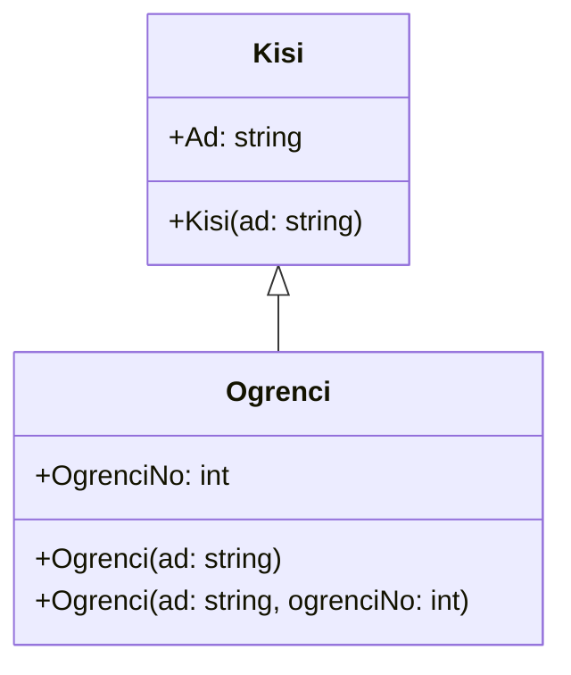
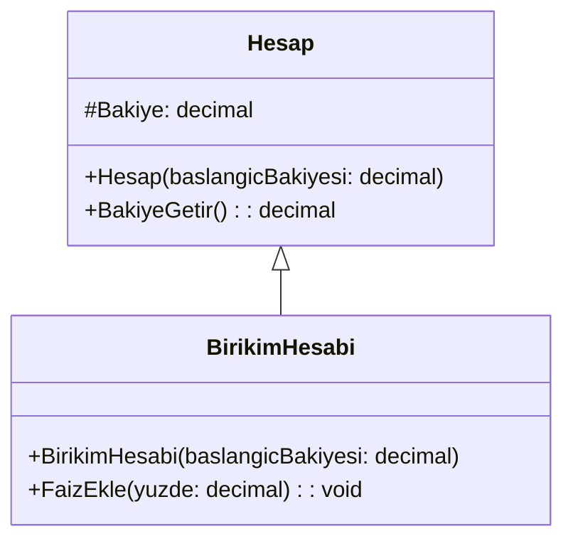
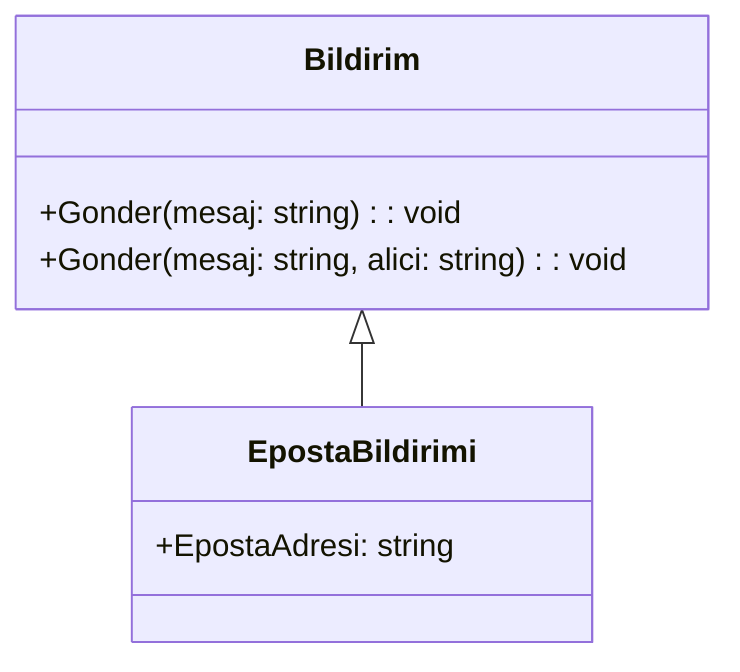

# Hafta 06 — Kalıtımda `base` ve overload

Bu hafta Hafta 05'te öğrendiğimiz kalıtım konusuna devam edeceğiz. Üst sınıfın kurucusunu alt sınıftan çağırmayı, alt sınıfta birden fazla kurucu tanımlamayı ve üst sınıftan gelen metotları kullanmayı öğreneceğiz. Örnekler orta seviyeye doğru ilerler; her örnekte önce sınıf diyagramı, sonra C# kodu bulunur.

## Öğrenme hedefleri

Bu dokümanın sonunda:

- `base(...)` ile üst sınıf kurucusunun nasıl çağrıldığını açıklayabilecek,
- Alt sınıfta kurucu overload tanımlayabilecek,
- `protected` üyelerin kimler tarafından kullanılabildiğini anlayabilecek,
- Üst sınıftan miras alınan overload metotları kullanabileceksiniz.

## 1. Alt sınıf kurucusu ve `base`

Bir alt sınıf nesnesi oluşturulurken önce üst sınıfın o nesneye ait bölümü hazırlanır. Üst sınıf bir parametre alan kurucuya sahipse, alt sınıf bu kurucuyu `base(...)` ile çağırır.

### Örnek 1 — Kişi ve öğrenci

**Sınıf diyagramı**



**C# kodu**

```csharp
using System;

class Kisi
{
    public string Ad { get; set; }

    public Kisi(string ad)
    {
        Ad = ad;
    }
}

class Ogrenci : Kisi
{
    public int OgrenciNo { get; set; }

    public Ogrenci(string ad) : base(ad)
    {
    }

    public Ogrenci(string ad, int ogrenciNo) : base(ad)
    {
        OgrenciNo = ogrenciNo;
    }
}

class Program
{
    static void Main()
    {
        Ogrenci yeniOgrenci = new Ogrenci("Deniz");
        Ogrenci kayitliOgrenci = new Ogrenci("Ece", 2026001);

        Console.WriteLine(yeniOgrenci.Ad);
        Console.WriteLine($"{kayitliOgrenci.Ad} - {kayitliOgrenci.OgrenciNo}");
    }
}
```

`Ogrenci` sınıfının iki kurucusu vardır. Birincisi yalnızca adı, ikincisi ise adı ve öğrenci numarasını alır. Aynı isimli kurucuların farklı parametrelerle tanımlanmasına **kurucu overload** denir.

Her iki kurucudaki `: base(ad)` ifadesi, adı `Kisi` sınıfının kurucusuna gönderir. Böylece `Ad` değerini üst sınıf belirler. Kurucular alt sınıftan otomatik olarak miras alınmaz; `Ogrenci` için kullanılacak kurucular alt sınıfta tanımlanır.

## 2. `protected` üyeler

Bir üyenin yalnızca sınıfın kendisinden ve o sınıftan türeyen alt sınıflardan kullanılmasını istiyorsak `protected` kullanabiliriz. Bu üye, `public` gibi programın her yerinden erişilebilir değildir.

### Örnek 2 — Hesap ve birikim hesabı

**Sınıf diyagramı**



**C# kodu**

```csharp
using System;

class Hesap
{
    protected decimal Bakiye { get; set; }

    public Hesap(decimal baslangicBakiyesi)
    {
        Bakiye = baslangicBakiyesi;
    }

    public decimal BakiyeGetir()
    {
        return Bakiye;
    }
}

class BirikimHesabi : Hesap
{
    public BirikimHesabi(decimal baslangicBakiyesi) : base(baslangicBakiyesi)
    {
    }

    public void FaizEkle(decimal yuzde)
    {
        Bakiye += Bakiye * yuzde / 100;
    }
}

class Program
{
    static void Main()
    {
        BirikimHesabi hesap = new BirikimHesabi(1000);
        hesap.FaizEkle(10);

        Console.WriteLine($"Bakiye: {hesap.BakiyeGetir()}");
    }
}
```

Diyagramda `#` işareti `protected` anlamına gelir. `Bakiye` değerine `BirikimHesabi` içindeki `FaizEkle` metodu erişebilir. Ancak `Main` içinden `hesap.Bakiye` yazılarak doğrudan erişilemez. Başlangıç bakiyesi ise `base(baslangicBakiyesi)` ile `Hesap` kurucusuna gönderilir.

## 3. Overload metotlar ve kalıtım

**Overload**, aynı sınıfta aynı isimli birden fazla metot bulunmasıdır. Metotların parametre sayısı veya parametre türleri farklı olmalıdır. Yalnızca dönüş türünü değiştirmek overload oluşturmaz.

Üst sınıfta tanımlanan bu metotlar alt sınıfa miras kalır. Alt sınıf nesnesi, uygun parametreleri vererek istediği overload'ı çağırabilir.

### Örnek 3 — Bildirim gönderme

**Sınıf diyagramı**



**C# kodu**

```csharp
using System;

class Bildirim
{
    public void Gonder(string mesaj)
    {
        Console.WriteLine($"Bildirim: {mesaj}");
    }

    public void Gonder(string mesaj, string alici)
    {
        Console.WriteLine($"{alici} adresine bildirim: {mesaj}");
    }
}

class EpostaBildirimi : Bildirim
{
    public string EpostaAdresi { get; set; } = "";
}

class Program
{
    static void Main()
    {
        EpostaBildirimi bildirim = new EpostaBildirimi();
        bildirim.EpostaAdresi = "deniz@example.com";

        bildirim.Gonder("Ders saat 10.00'da başlayacak.");
        bildirim.Gonder("Ödev teslim tarihi yaklaşıyor.", bildirim.EpostaAdresi);
    }
}
```

`EpostaBildirimi`, `Bildirim` sınıfından kalıtım aldığı için iki `Gonder` metodunu da kullanabilir. Tek parametre verildiğinde ilk metot, mesaj ve alıcı verildiğinde ikinci metot çağrılır. Hangi metodun seçileceğini gönderilen argümanlar belirler.

## Dikkat edilecek noktalar

- `base(...)`, alt sınıf kurucusundan üst sınıf kurucusuna değer göndermek için kullanılır.
- Üst sınıfta parametreli bir kurucu varsa, alt sınıf kurucusu uygun üst sınıf kurucusunu çağırmalıdır.
- Kurucular alt sınıfa otomatik olarak aktarılmaz; alt sınıf kendi kurucularını tanımlar.
- Overload metotlarda isim aynıdır, ancak parametre listeleri farklıdır.
- `protected` üyeye üst sınıf ve onun alt sınıfları erişebilir; sınıf dışındaki kod doğrudan erişemez.

## Kısa özet

- `base(deger)`, üst sınıf kurucusunu çalıştırır ve gerekli değeri ona iletir.
- Aynı sınıfta farklı parametrelere sahip kurucular tanımlanabilir; buna kurucu overload denir.
- Üst sınıfın overload metotları, alt sınıf nesnesi üzerinden kullanılabilir.
- `protected`, bir üyeyi alt sınıfların kullanmasına izin verirken dışarıya kapalı tutar.

## Alıştırmalar

Her alıştırmada önce sınıf diyagramını çizin, sonra C# kodunu yazın.

1. `Calisan` ve `Ogretmen` sınıfları oluşturun. `Calisan` kurucusu ad bilgisini alsın. `Ogretmen` kurucusu `base(...)` ile adı üst sınıfa iletsin ve ayrıca branş bilgisini alsın.
2. `Kitap` sınıfında kitabı yalnızca adla veya ad ve yazarla oluşturabilecek iki kurucu overload tanımlayın.
3. `Rapor` üst sınıfında `Yazdir` metodunun metinsiz ve başlık alan iki overload'ını tanımlayın. `OgrenciRaporu` sınıfı `Rapor` sınıfından kalıtım alsın ve bu metotları kullansın.
